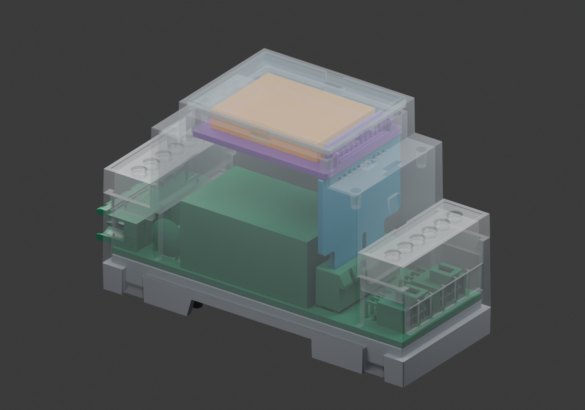
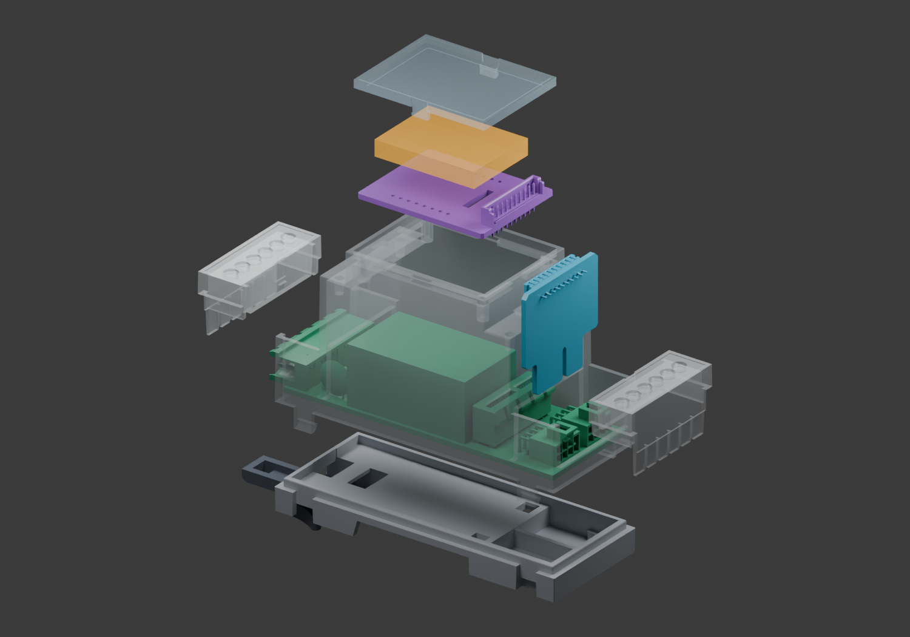
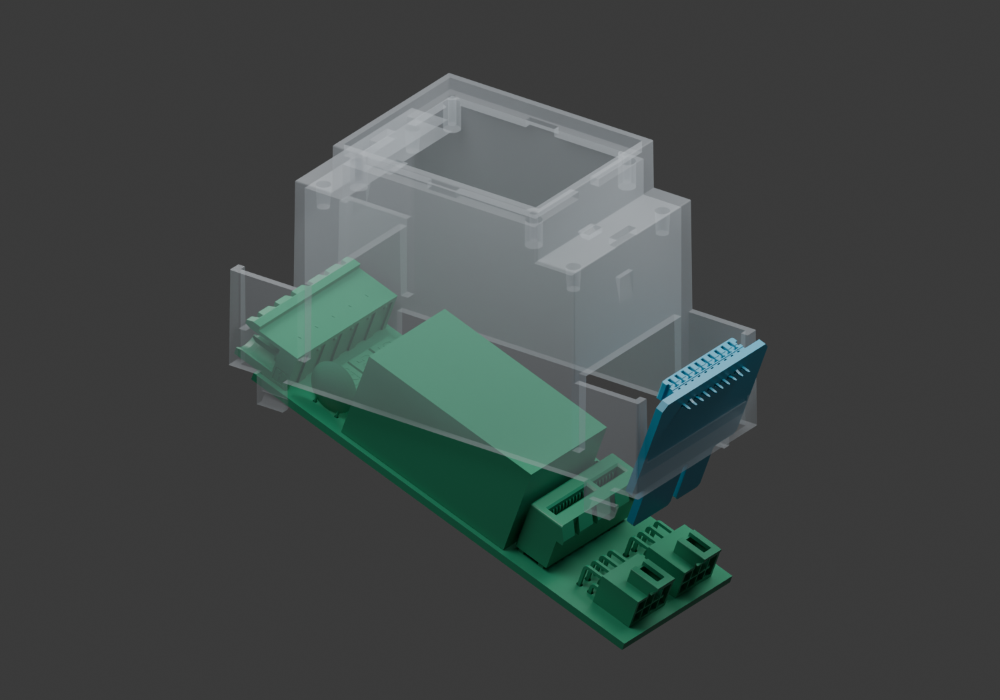

# DIN Rail Energy Monitor

Aggregation repository for the Whatnick DIN rail energy-monitor hardware,
firmware, and open NILM development-platform roadmap.

## Open NILM platform

The delivered Crowd Supply architecture is being recovered as a modular
development platform for coherent waveform acquisition, FPGA/ASIC metrology,
local processing, and reproducible non-intrusive load monitoring research. Its
primary audience is universities, teaching laboratories, small research labs,
and open-hardware teams rather than the commodity consumer-monitor market.

See the [open NILM platform assessment and staged plan](docs/open-nilm-platform.md).

## v2.0 enclosure-fit study

Branch: `feature/v2.0-enclosure-fit`. The first board change recesses the power
base's Nano-Fit CT connectors by 2 mm
([whatnick/din_power_atm90e26#2](https://github.com/whatnick/din_power_atm90e26/issues/2)).
The enclosure is provisionally identified as **Bud DMB-4770 with DMB-4770-CC**
from its exact 86.9 x 32.8 mm base-PCB dimensions.

Green: power/sampling base. Blue: metering riser. Purple: isolated host/display
carrier. Amber: **unspecified display keep-out**, not a selected display.
The enclosure uses manufacturer STEP geometry; the standard cover is rendered
transparent as a representative of the optional clear cover. Missing legacy
component models are listed in the fit report, not silently treated as empty space.

The insertion image is a **candidate motion, not proof of clearance**. The
90 mm body cannot be treated as a simple slide-in tube through its small display
opening. Remove the base, guards and cover; evaluate the lower power/metering
subassembly entering from the rear and fit the host carrier separately.
The sampled rotation checks and actual intersections are recorded in
[`mechanical/fit-report.json`](mechanical/fit-report.json).
**All four tested insertion candidates collide.** The power board's supplied
Phoenix terminal model intersects the body/left guard, and the host/riser seating
still needs correction. The Nano-Fit models no longer intersect their guard.
The parent deliberately selects the experimental v2.0-fit PCB; the original
power PCB remains intact because three CT connections are not yet routed.

[`mechanical/assembly.json`](mechanical/assembly.json) records tool-neutral
datums, transforms, nominal board levels, source links, insertion candidates
and unresolved seating assumptions. See the
[reproduction and release gates](mechanical/README.md).
This fit prototype preserves the isolated-host slot and existing ground-domain
separation. **It is not an approved SELV base or a direct-mains production release.**

## Connectors BOM

Stereo cable assembly [Multicomp](https://au.element14.com/pro-signal/ps000043/adapter-stereo-3-5mm-rcpt-rcpt/dp/2787082)
