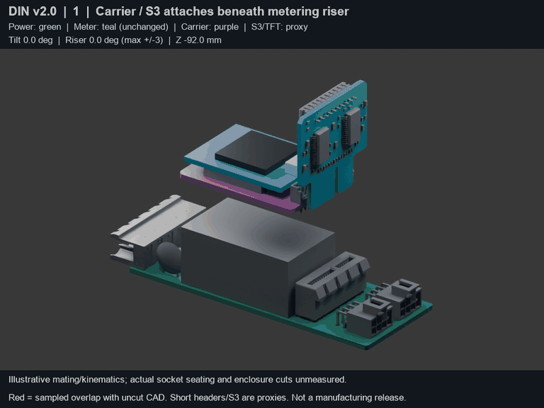
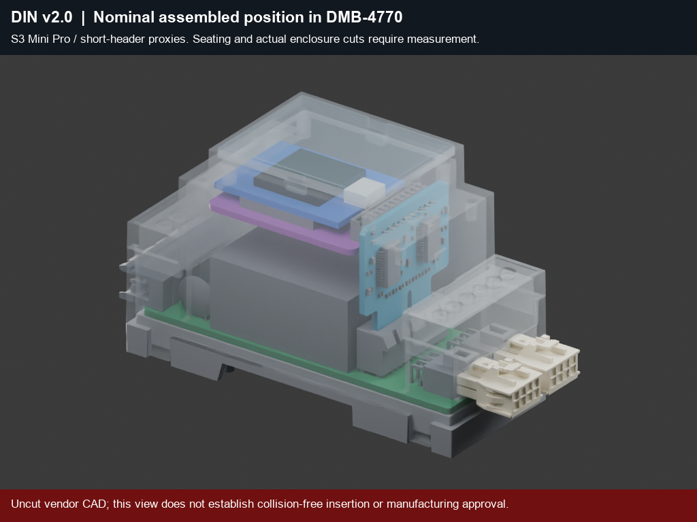

# DIN Rail Energy Monitor

Aggregation repository for the Whatnick DIN rail energy-monitor hardware,
firmware, and open NILM development-platform roadmap.

## Open NILM platform

The delivered Crowd Supply architecture is being recovered as a modular
development platform for coherent waveform acquisition, FPGA/ASIC metrology,
local processing, and reproducible non-intrusive load monitoring research. Its
primary audience is universities, teaching laboratories, small research labs,
and open-hardware teams rather than the commodity consumer-monitor market.

See the [open NILM platform assessment and staged plan](docs/open-nilm-platform.md).

## v2.0 three-PCB enclosure assembly

The power and isolated-carrier submodules now use their canonical designs,
not experimental board copies. The shortened **84.65 x 32.8 mm power PCB has
R1 corners** and retains Nano-Fit connectors and eight permanent CT burdens.
The carrier has **R2 corners** and preserves its isolation slot and ground
domains. The metering PCB and its submodule revision are unchanged.

Both updated boards pass their configured **ERC, all-track DRC, schematic
parity and unconnected-item checks**. Canonical project files and validation
reports live in the respective submodules:
[power](KiCAD_PCBs/din_power_atm90e26/README.md) and
[carrier](KiCAD_PCBs/din_isolated_SPI/README.md).
Superseded candidate boards, comparison renders and study scripts have been
removed from the active repositories; earlier committed work remains in Git history.

### Board assembly followed by whole-assembly insertion

[Download the MP4 animation](mechanical/renders/assembly-insertion.mp4) ·
[Exploded board set](mechanical/renders/exploded.png) ·
[Source hashes and sampled contacts](mechanical/fit-report.json)

The sequence attaches the carrier to the metering board from below, inserts
the combined pair into the power PCB's PCI slot, then rotates and inserts the
entire set through the open rear of the **Bud DMB-4770**. Nano-Fit cable
plugs are fitted **after** the boards are seated. It uses the **LOLIN S3 Mini
Pro's integrated TFT**, rather than a separate OLED stack, with provisional
2.5 mm short-header bodies and up to **3 degrees** of riser motion.
The carrier is modeled to the left of the riser and lower than before, with
the TFT top approximately flush with the metering PCB top. This is a
provisional placement, not a measured connector seat.

**This is a nominal motion, not a verified collision-free insertion.**
The animation identifies the first sampled contact and highlights subsequent
intersections in red while continuing toward the nominal seat. The vendor
enclosure model is **uncut**; the user reports physical fit with enclosure
cuts, whose dimensions have not yet been measured. Riser motion is a kinematic
allowance, not validated FR4 bending or connector retention.

[Mechanical datums, assumptions and reproduction](mechanical/README.md) ·
[Publication checksums and decode checks](mechanical/publication-manifest.json) ·
[Existing physical product](docs/Assembled_v1.jpg)

Socket engagement, S3 pin compatibility and underside components, actual
enclosure cuts, J1 model identity and cable bends still require physical
validation. The lower display position, short-header gap and connector seating
datums have not yet been measured.
Passing configured electrical checks does **not** establish
SELV compliance, mains safety or fabrication approval.

## Connectors BOM

Stereo cable assembly:
[Multicomp / Pro Signal PS000043](https://au.element14.com/pro-signal/ps000043/adapter-stereo-3-5mm-rcpt-rcpt/dp/2787082).
